# 🌤️ Dokumentasi Sinkronisasi Iklim Dinamis (Dynamic Climate Sync)

Dokumentasi ini menjelaskan arsitektur, strategi ekstraksi koordinat, pemanggilan batch API ke Open-Meteo, serta mekanisme penyimpanan terdistribusi ke masing-masing tabel fitur (*Rainfall, Temperature, Soil Moisture*) di PostgreSQL/PostGIS.

---

## 📌 1. Latar Belakang & Konsep Arsitektur

Sistem pemantauan karhutla ini menggabungkan dua paradigma data iklim:
1. **Data Historis Statis (ERA5 NetCDF/CSV):** Mencakup rentang waktu lampau (hingga bulan Agustus/Oktober) dengan grid dense ~18.000 titik di seluruh daratan Indonesia.
2. **Data Berjalan Dinamis (Open-Meteo API):** Untuk bulan berjalan (November dan seterusnya), titik api aktif dideteksi secara dinamis oleh satelit NASA FIRMS. Data cuaca (suhu udara, curah hujan, dan kelembapan tanah) di sekitar titik api tersebut diambil secara *real-time* dari Open-Meteo API.

```mermaid
flowchart TD
    subgraph Data Input
        FIRMS["NASA FIRMS Satellite Sync (VIIRS 375m)"]
        ERA5["Data Historis ERA5 (Statis s/d Okt)"]
    end

    subgraph Hotspot Extraction
        HOTSPOTS[("Tabel hotspots (PostgreSQL + PostGIS)")]
        DEDUP["Deduplikasi Spasial (ROUND lat/lon 2 desimal ~1km)"]
    end

    subgraph Weather Batch Fetcher
        WM["Open-Meteo API (Batch Coordinates)"]
    end

    subgraph Modular Feature Ingestion
        T_SYNC["app.features.temperature.sync"]
        R_SYNC["app.features.rainfall.sync"]
        S_SYNC["app.features.soil_moisture.sync"]

        T_TBL[("Tabel temperature")]
        R_TBL[("Tabel rainfall_data")]
        S_TBL[("Tabel soil_moisture_data")]
    end

    FIRMS --> HOTSPOTS
    HOTSPOTS --> DEDUP
    DEDUP --> WM
    WM --> T_SYNC --> T_TBL
    WM --> R_SYNC --> R_TBL
    WM --> S_SYNC --> S_TBL
    ERA5 -.-> T_TBL & R_TBL & S_TBL
```



---

## ⚡ 2. Strategi Grid Daratan Indonesia (968 Titik) & Batching

### Masalah Awal:
* Jika hanya mengambil koordinat titik kebakaran, layer peta di frontend akan bolong/kosong di pulau-pulau yang tidak ada kebakarannya (hanya muncul bercak putih di sekitar titik api).
* Pengambilan per-titik tanpa grid daratan tidak menghasilkan peta raster yang kontinu.

### Solusi yang Diimplementasikan:
1. **Grid Daratan Indonesia (~968 Titik, Resolusi 0.5° / ~50 km):**
   * Diambil dari titik-titik daratan resmi Indonesia (`is_indonesia = true`) dari Sabang sampai Merauke.
   * 968 titik ini mencakup seluruh pulau (Sumatera, Jawa, Bali, Nusa Tenggara, Kalimantan, Sulawesi, Maluku, Papua).
   * Ditambah titik-titik hotspot aktif untuk akurasi maksimal di pusat kebakaran.

2. **Multi-Coordinate Batch Query:**
   * 968 titik daratan dibagi menjadi *chunk* 50 titik per HTTP request.
   * Total hanya **~20 request HTTP** yang selesai dalam waktu **~15 detik**.
   * Sangat hemat: 20 request hanya menggunakan **0,2%** kuota harian 10.000 Open-Meteo.
   * Dilengkapi proteksi *exponential backoff retry* jika terjadi limit burst per menit (HTTP 429).

3. **Rendering Raster Adaptif di Frontend (`ClimateLayer.tsx`):**
   * Komponen kanvas raster kini dilengkapi *adaptive interpolation radius* (radius 3 piksel untuk grid dinamis), sehingga titik-titik grid 0.5° otomatis menyatu dan membentuk gradasi warna yang halus dan kontinu di seluruh kepulauan Indonesia.

4. **Respon Cepat Saat Titik Api Diklik (`HotspotLayer.tsx`):**
   * Data cuaca, lahan gambut, dan kluster spasial dari database lokal kini ditampilkan secara **instan (< 15ms)** di popup dan sidebar tanpa menunggu layanan pihak ketiga Esri ArcGIS yang lambat.


---

## 🗄️ 3. Distribusi Data ke Masing-Masing Tabel Fitur

Setiap fitur memiliki modul dan fungsi sinkronisasi terpisah untuk menjaga prinsip *separation of concerns*:

| Fitur | File Modul Sync | Tabel PostGIS | Kolom Nilai |
| :--- | :--- | :--- | :--- |
| **Suhu Udara** | [`backend/app/features/temperature/sync.py`](file:///home/allrole/Documents/Mata Kuliah/spasial/backend/app/features/temperature/sync.py) | `temperature` | `suhu_celsius` |
| **Curah Hujan** | [`backend/app/features/rainfall/sync.py`](file:///home/allrole/Documents/Mata Kuliah/spasial/backend/app/features/rainfall/sync.py) | `rainfall_data` | `curah_hujan_mm` |
| **Kelembapan Tanah** | [`backend/app/features/soil_moisture/sync.py`](file:///home/allrole/Documents/Mata Kuliah/spasial/backend/app/features/soil_moisture/sync.py) | `soil_moisture_data` | `soil_moisture` |

### Konsistensi Snapshot:
* Semua record dalam satu sesi sinkronisasi di-generate dengan:
  * `waktu`: Timestamp identik (misal `2026-11-02 04:13:34`).
  * `is_indonesia`: `TRUE`.
  * `geom`: Geometri PostGIS `Point(longitude latitude)` dengan SRID 4326.
* Menggunakan **PostgreSQL Bulk Insert** (`chunk_size=1000`) sehingga 1.000 record tersimpan dalam waktu **< 0.1 detik**.

---

## 🚀 4. Orkestrasi Terpadu & Otomatisasi

### A. Otomatisasi Terintegrasi dengan NASA FIRMS
Di [`backend/app/features/hotspot/sync.py`](file:///home/allrole/Documents/Mata Kuliah/spasial/backend/app/features/hotspot/sync.py), begitu satelit mendeteksi hotspot baru dan berhasil menyimpannya ke database, sistem secara otomatis mengeksekusi:
```python
if filtered_records:
    from app.features.hotspot.climate_sync import sync_all_climate_for_hotspots
    new_coords = [(float(r["latitude"]), float(r["longitude"])) for r in filtered_records]
    await sync_all_climate_for_hotspots(coordinates=new_coords)
```
Sehingga data cuaca untuk hotspot baru langsung tersedia tanpa tindakan manual.

### B. Endpoint API untuk Pemicu Manual

#### 1. Sinkronisasi Seluruh Iklim Sekaligus (Rekomendasi)
* **Endpoint:** `POST /api/hotspots/sync-climate`
* **Query Parameters:**
  * `date` *(string, opsional)*: Format `YYYY-MM-DD` (contoh: `2026-11-01`). Jika kosong, otomatis mengambil tanggal hotspot terbaru.
  * `precision` *(int, opsional, default: 2)*: Presisi pembulatan desimal koordinat untuk deduplikasi spasial (~1 km).
* **Contoh Pemanggilan:**
  ```bash
  curl -X POST "http://localhost:5000/api/hotspots/sync-climate?date=2026-11-01&precision=1"
  ```
* **Contoh Response:**
  ```json
  {
    "status": "success",
    "message": "Berhasil sinkronisasi iklim dinamis untuk 983 lokasi hotspot.",
    "synced_locations": 983,
    "temperature_inserted": 983,
    "rainfall_inserted": 983,
    "soil_moisture_inserted": 983,
    "timestamp": "2026-11-02T04:13:34.367431"
  }
  ```

#### 2. Sinkronisasi Individual per Fitur
* **Curah Hujan:** `POST /api/rainfall/sync`
* **Suhu Udara:** `POST /api/temperature/sync`
* **Kelembapan Tanah:** `POST /api/soil-moisture/sync`
* *Catatan:* Jika parameter `lat` & `lon` disertakan, sinkronisasi hanya dilakukan pada 1 titik tersebut. Jika dikosongkan, otomatis mengambil seluruh koordinat hotspot.

---

## 🔍 5. Penggunaan pada Analisis Spasial Hotspot (Spatial Context)

Ketika pengguna mengklik titik hotspot di peta frontend, endpoint berikut dipanggil:
* `GET /api/hotspots/context?lat=-4.6&lng=120.1&date=2026-11-01`

Sistem menjalankan PostGIS KNN Distance Operator (`geom <-> ...`) terhadap data dinamis terbaru di tabel iklim:
```json
{
  "status": "success",
  "lat": -4.6,
  "lng": 120.1,
  "is_peatland": false,
  "province": "Sulawesi Selatan",
  "cluster": {
    "nearby_count": 21,
    "nearest_neighbor_km": 5.15,
    "radius_km": 15
  },
  "temperature": {
    "value": 31.3,
    "unit": "°C",
    "category": "Hangat"
  },
  "soil_moisture": {
    "value": 0.113,
    "unit": "m³/m³",
    "category": "Sangat Kering (Kritis)"
  },
  "rainfall": {
    "value": 0.1,
    "unit": "mm",
    "category": "Kering / Sangat Ringan"
  }
}
```
Hasil analisis biofisik di atas secara akurat mencerminkan kondisi cuaca titik kebakaran aktif pada bulan berjalan!
