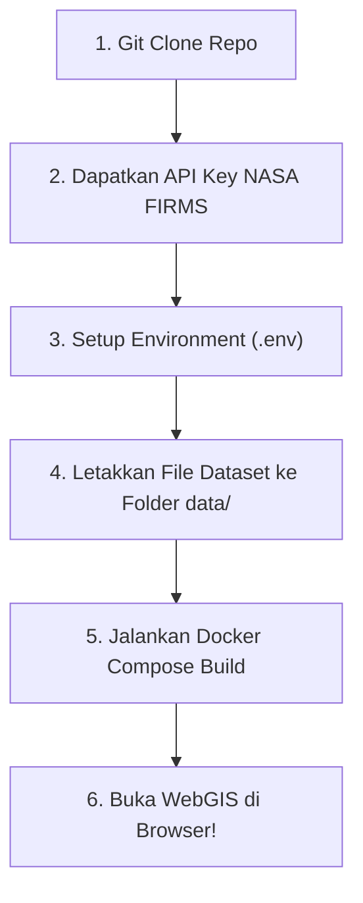

# 🛰️ WebGIS Pemantauan Titik Api (NASA FIRMS) & Lahan Gambut Indonesia

Panduan lengkap *step-by-step* untuk anggota tim: mulai dari clone repo, registrasi & pasang API Key NASA FIRMS, setup layer Esri Sentinel-2 Land Cover, hingga build dan menjalankan proyek via Docker.

---

## ⚡ Quick Start: Panduan Langkah Demi Langkah Anggota Tim

Ikuti 5 langkah mudah berikut secara berurutan:



---

### Langkah 1: Clone Repository Monorepo
Buka terminal di komputer anggota tim, lalu clone repository:
```bash
git clone https://github.com/Fairuz-DevCode/FIRMS-WEBGIS.git
cd FIRMS-WEBGIS
```

---

### Langkah 2: Dapatkan API Key NASA FIRMS (Gratis)
Aplikasi ini membutuhkan API Key dari NASA FIRMS untuk mengambil data titik api kebakaran hutan (*near real-time*):

1. Buka halaman registrasi NASA FIRMS: 👉 **[https://firms.modaps.eosdis.nasa.gov/api/map_key/](https://firms.modaps.eosdis.nasa.gov/api/map_key/)**
2. Masukkan alamat email kamu.
3. Cek inbox email kamu dari NASA FIRMS. Kamu akan mendapatkan kode **MAP_KEY** sepanjang 32 karakter (contoh: `a1b2c3d4e5f67890123456789abcdef0`).

---

### Langkah 3: Konfigurasi Environment (`.env`)
1. Salin template `.env.example` yang ada di folder backend menjadi `.env`:
   ```bash
   cp backend/.env.example backend/.env
   ```
2. Buka file `backend/.env` menggunakan text editor (VS Code, Nano, dll), lalu ganti nilai `MAP_KEY` dengan kunci 32-karakter yang kamu dapatkan di Langkah 2:
   ```ini
   PORT=5000
   DB_HOST=db
   DB_USER=firms_user
   DB_PASSWORD=firms_password
   DB_NAME=firms_db
   DB_PORT=5432
   DATABASE_URL=postgresql+psycopg2://firms_user:firms_password@db:5432/firms_db
   ASYNC_DATABASE_URL=postgresql+asyncpg://firms_user:firms_password@db:5432/firms_db

   # GANTI DENGAN KEY NASA KAMU:
   MAP_KEY=masukkan_32_karakter_key_nasa_disini
   ```

> [!NOTE]
> **Tentang API Esri Sentinel-2 Land Cover 10m:**
> Untuk layer tutupan lahan **Esri Sentinel-2 LULC**, anggota tim **TIDAK PERLU API Key** atau token khusus! Layanan ini sudah terkonfigurasi di frontend dan langsung terhubung secara publik ke ArcGIS ImageServer:
> `https://ic.imagery1.arcgis.com/arcgis/rest/services/Sentinel2_10m_LandCover/ImageServer/WMSServer`

---

### Langkah 4: Siapkan Folder Dataset (`data/`)
Karena file dataset mentah berukuran besar dan tidak di-push ke GitHub (`.gitignore`), pastikan anggota tim meminta/menyalin file dataset dari tim dan meletakkannya di folder `data/` dengan struktur seperti ini:

```text
FIRMS-WEBGIS/
├── data/
│   ├── hotspots_7years_clean.csv                <-- Dataset 7 tahun titik api
│   ├── era5_clean_7_tahun.csv                  <-- Dataset iklim ERA5 (suhu, hujan, kelembaban)
│   └── raw data/
│       └── Indonesia_Peat_Lands.geojson        <-- Polygon kubah lahan gambut Indonesia
```

---

### Langkah 5: Build & Jalankan dengan Docker
Pastikan Docker Desktop / Docker Engine sudah aktif di komputer kamu, lalu jalankan:

```bash
docker compose up --build
```

> [!TIP]
> **Apa yang terjadi saat perintah ini dijalankan?**
> 1. **Database PostGIS (`firms_postgres_db`)** otomatis dibuat dan menjalankan `init.sql`. Data titik api 7 tahun (`hotspots_7years_clean.csv`) langsung di-seed via PostGIS COPY.
> 2. **Backend FastAPI (`firms_backend`)** otomatis menjalankan `entrypoint.sh` & `seed.py` untuk mengimpor polygon gambut (`Indonesia_Peat_Lands.geojson`) dan data iklim ERA5 (`era5_clean_7_tahun.csv`) ke PostGIS.
> 3. **Frontend React Vite (`firms_frontend`)** otomatis di-build menjadi bundle production dan disajikan melalui web server **Nginx** dengan reverse proxy ke backend.

---

### Langkah 6: Akses Aplikasi di Browser
Setelah proses build selesai dan log terminal menampilkan *Application startup complete*, buka browser kamu:

| Komponen | Alamat URL | Keterangan |
| :--- | :--- | :--- |
| 🌐 **Aplikasi WebGIS** | **[http://localhost:3000](http://localhost:3000)** | Tampilan peta interaktif, filter tanggal satelit, layer tutupan lahan Esri & polygon gambut |
| 📑 **API Documentation** | **[http://localhost:5000/docs](http://localhost:5000/docs)** | Dokumentasi Swagger API FastAPI interaktif |
| 🗄️ **pgAdmin Database** | **[http://localhost:5050](http://localhost:5050)** | GUI PostgreSQL/PostGIS (Email: `admin@admin.com` / Pass: `admin`) |

---

## 🛰️ Cara Menggunakan Fitur Utama di Tampilan WebGIS

### 1. Sinkronisasi Hotspot NASA FIRMS Terbaru
- Di antarmuka WebGIS, terdapat tombol sinkronisasi data FIRMS.
- Saat tombol ditekan, backend akan langsung memanggil API NASA FIRMS menggunakan `MAP_KEY` kamu untuk mengambil data titik api terbaru (VIIRS / MODIS) di seluruh wilayah Indonesia dan menampilkannya di peta.

### 2. Mengaktifkan Layer Esri Sentinel-2 Land Cover (Tutupan Lahan)
- Buka panel **Layer Control** di pojok kanan atas peta.
- Centang layer **Tutupan Lahan (Land Cover)**.
- Pilih provider **Esri Sentinel-2 10m LULC**.
- Peta akan menampilkan klasifikasi tutupan lahan resolusi tinggi (10 meter) secara otomatis:
  - 🟩 **Hijau**: Hutan / Kanopi Rapat
  - 🟦 **Biru**: Badan Air / Danau / Sungai
  - 🟪 **Ungu Muda**: Rawa / Lahan Basah / Gambut Tergenang
  - 🟨 **Kuning**: Pertanian / Perkebunan
  - 🟥 **Merah**: Pemukiman / Lahan Terbangun
  - 🟫 **Cokelat**: Tanah Terbuka / Gundul

### 3. Analisis Spasial Titik Api di Lahan Gambut
- Aktifkan layer **Lahan Gambut Indonesia**.
- Klik salah satu titik api (hotspot) di peta untuk melihat popup informasi:
  - Tingkat kepercayaan (*confidence*) & daya radiasi api (*FRP - Fire Radiative Power*).
  - Status apakah titik api berada di dalam kawasan kubah gambut (**PostGIS `ST_Intersects`**).
  - Estimasi faktor lingkungan: suhu udara permukaan (°C), curah hujan (mm), dan tingkat kelembaban tanah.

---

## 🛠️ Perintah Berguna Lainnya

- **Menghentikan Kontainer:**
  ```bash
  docker compose down
  ```
- **Melihat Log Kontainer Secara Realtime:**
  ```bash
  docker compose logs -f
  ```
- **Reset Database & Memulai Ulang dari Awal:**
  ```bash
  docker compose down -v
  docker compose up --build
  ```
