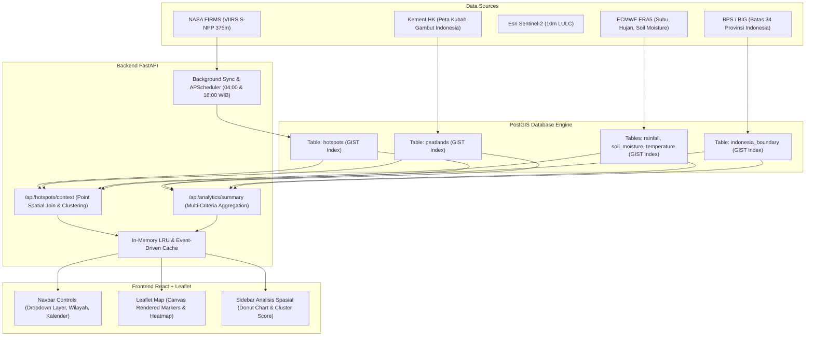

# 🛰️ WebGIS Pemantauan Titik Api (NASA FIRMS) & Analisis Spasial Ekosistem Gambut Indonesia

Dokumentasi komprehensif arsitektur sistem, konsep spasial, metode analisis (Multi-Criteria Fire Risk & Forensik Kebakaran Alami vs Manusia), optimasi caching, PostGIS spatial join, hingga panduan setup lokal.

---

## 📑 Daftar Isi
1. [Arsitektur & Konsep Utama Proyek](#-arsitektur--konsep-utama-proyek)
2. [Metodologi Analisis Data Spasial](#-metodologi-analisis-data-spasial)
   - [A. Analisis Probabilitas Pemicu Kebakaran: Ulah Manusia vs Alami](#a-analisis-probabilitas-pemicu-kebakaran-ulah-manusia-vs-alami)
   - [B. Multi-Criteria Evaluation (MCE) Skor Risiko Karhutla](#b-multi-criteria-evaluation-mce-skor-risiko-karhutla)
   - [C. Analisis Kedekatan & Kepadatan Kluster Spasial (Spatial Clustering)](#c-analisis-kedekatan--kepadatan-kluster-spasial-spatial-clustering)
3. [Arsitektur Geospasial & Pemrosesan Data PostGIS](#-arsitektur-geospasial--pemrosesan-data-postgis)
   - [A. Pemotongan Layer Sesuai Batas Wilayah Indonesia (Boundary Clipping)](#a-pemotongan-layer-sesuai-batas-wilayah-indonesia-boundary-clipping)
   - [B. Strategi Caching Berbasis Event-Driven & Indexed Query](#b-strategi-caching-berbasis-event-driven--indexed-query)
   - [C. Spatial Indexing (GIST) & Spatial KNN Operator](#c-spatial-indexing-gist--spatial-knn-operator)
4. [Tampilan Antarmuka Baru (Navbar Dropdowns & Sidebar Analitik)](#-tampilan-antarmuka-baru-navbar-dropdowns--sidebar-analitik)
5. [Panduan Menjalankan Proyek (Docker Quickstart)](#-panduan-menjalankan-proyek-docker-quickstart)

---

## 🏛️ Arsitektur & Konsep Utama Proyek

Sistem ini dirancang untuk menjawab kebutuhan analisis ilmiah geografi dan kehutanan: **menghubungkan data kejadian kebakaran aktif (NASA FIRMS) dengan parameter biofisik lingkungan (iklim ERA5, tutupan lahan Sentinel-2, dan peta lahan gambut KLHK)**.



---

## 🔬 Metodologi Analisis Data Spasial

### A. Analisis Probabilitas Pemicu Kebakaran: Ulah Manusia vs Alami

Di wilayah tropis basah seperti Indonesia, **kebakaran hutan alami spontan sangat jarang terjadi** dan hampir 90-99% karhutla dipicu oleh intervensi manusia (pembukaan lahan pertanian/perkebunan murah dengan metode tebas-bakar / *slash-and-burn*).

Sistem menerapkan model inferensi spasial dinamis ketika sebuah titik api diklik:

```text
Probabilitas Manusia (%) = Baseline (85%) ± Koreksi Tutupan Lahan ± Koreksi Kluster Spasial ± Koreksi Suhu Udara
Probabilitas Alami (%)   = 100% - Probabilitas Manusia (%)
```

#### Parameter Penentu:
1. **Tutupan Lahan (Sentinel-2 10m LULC):**
   - **Semak Belukar / Padang Rumput / Tanaman Pangan (Crops/Rangeland):** Menambah indikasi manusia **(+8%)**. Menandakan area konsesi atau persiapan tanam.
   - **Hutan Lebat (Trees/Flooded Vegetation):** Mengindikasikan perambahan batas hutan atau kebakaran liar yang merambat.
2. **Kepadatan Kluster Spasial (Spatial Clustering):**
   - Dihitung menggunakan radius tetangga 15 km (`ST_Expand` & `ST_Distance`).
   - Jika terdapat $\ge 10$ titik api berdekatan dalam radius 15 km $\rightarrow$ Indikasi kuat **pembakaran terorganisir/serentak (+5%)**.
   - Jika titik api berdiri sendiri (terisolasi) $\rightarrow$ Indikasi pembakaran skala kecil lokal **(-15%)**.
3. **Suhu Udara Permukaan (ERA5 2m Temperature):**
   - Suhu normal tropis (24°C – 32°C) membuktikan tidak ada panas anomali matahari ekstrem untuk menyulut api secara alami.
   - Suhu panas ekstrem (> 34°C) sedikit meningkatkan faktor kerentanan alami akibat penguapan serasah kering **(-10% faktor manusia)**.

Hasil disajikan dalam bentuk **Donut/Pie Chart Interaktif** di Sidebar Kanan lengkap dengan poin argumentasi ilmiah.

---

### B. Multi-Criteria Evaluation (MCE) Skor Risiko Karhutla

Tingkat keparahan titik api dikuantifikasi dalam rentang skor **0 hingga 100 poin**:

$$\text{Skor Risiko} = S_{\text{Gambut}} (35\%) + S_{\text{Kekeringan Tanah}} (25\%) + S_{\text{Defisit Hujan}} (20\%) + S_{\text{Intensitas Api}} (20\%)$$

| Parameter | Kondisi | Poin Bobot | Dasar Ilmiah |
| :--- | :--- | :---: | :--- |
| **Karakteristik Gambut** | Di Dalam Lahan Gambut | **35 pts** | Gambut terbakar di bawah permukaan (*subsurface smoldering*), menghasilkan kabut asap tinggi dan sangat sulit padam. |
| | Tanah Mineral | **10 pts** | Api berada di permukaan, relatif lebih mudah dikendalikan. |
| **Kelembaban Tanah (m³/m³)** | $< 0.20$ (Sangat Kritis) | **25 pts** | Tanah kering kerontang, serasah mudah tersulut. |
| | $0.20 - 0.35$ (Cukup Kering) | **15 pts** | Zona rawan transisi. |
| | $> 0.35$ (Lembab/Jenuh) | **5 pts** | Kelembaban tanah tinggi meredam laju api. |
| **Curah Hujan (mm)** | $< 1.0\text{ mm}$ (Nir Hujan) | **20 pts** | Defisit air ekstrem. |
| | $1.0 - 5.0\text{ mm}$ (Sangat Ringan)| **12 pts** | Minim hujan. |
| | $> 5.0\text{ mm}$ (Hujan Sedang) | **3 pts** | Air hujan membasahi tajuk pohon. |
| **Intensitas Api & Confidence** | FRP $\ge 10\text{ MW}$ / High Conf | **20 pts** | Satelit mendeteksi radiasi termal berenergi masif. |
| | FRP $5 - 10\text{ MW}$ | **12 pts** | Energi panas moderat. |
| | FRP $< 5\text{ MW}$ / Low Conf | **5 pts** | Titik panas skala kecil. |

**Klasifikasi Akhir:**
- $\ge 75$ Poin: **Sangat Kritis** (Merah Pekat)
- $50 - 74$ Poin: **Tinggi** (Oranye Tua)
- $30 - 49$ Poin: **Sedang** (Kuning Amber)
- $< 30$ Poin: **Rendah** (Hijau)

---

### C. Analisis Kedekatan & Kepadatan Kluster Spasial (Spatial Clustering)

Menghitung keterkaitan spasial antar-kejadian kebakaran:
- **Spatial Radius Search:** Menghitung jumlah titik api lain dalam radius bounding box $0.15^\circ$ (~15 km).
- **Nearest Neighbor Distance:** Mengukur jarak titik api terdekat secara euklidian berbasis proyeksi derajat ke kilometer ($1^\circ \approx 111.32\text{ km}$).
- Membedakan apakah titik api tersebut adalah **Kluster Kebakaran Padat** (*Multi-Point Fire*) atau **Titik Tunggal Tersebar** (*Single Outlier*).

---

## 🗺️ Arsitektur Geospasial & Pemrosesan Data PostGIS

### A. Pemotongan Layer Sesuai Batas Wilayah Indonesia (Boundary Clipping)

Salah satu masalah awal adalah layer cuaca ERA5 dan titik api NASA yang berbentuk kotak persegi kasar (persegi *bounding box* memotong wilayah negara tetangga seperti Malaysia/Singapura, dan titik laut yang tidak relevan).

**Solusi yang Diterapkan:**
1. Mengimpor poligon resmi batas darat 34 Provinsi Indonesia ke tabel `indonesia_boundary` dengan indeks spasial GIST.
2. Menambahkan kolom `is_indonesia BOOLEAN` pada tabel `rainfall_data`, `soil_moisture_data`, dan `temperature`.
3. Menjalankan evaluasi spasial PostGIS:
   ```sql
   UPDATE rainfall_data r
   SET is_indonesia = TRUE
   FROM indonesia_boundary b
   WHERE r.geom && b.geom AND ST_Intersects(r.geom, b.geom);
   ```
4. Query frontend dan backend kini hanya memanggil `WHERE is_indonesia = TRUE`, sehingga kanvas interpolasi cuaca terpotong sempurna mengikuti kontur batas kepulauan Indonesia tanpa bocor ke laut maupun negara tetangga.

---

### B. Strategi Caching Berbasis Event-Driven & Indexed Query

Dengan jutaan baris titik api (2.1+ juta record) dan jutaan baris data cuaca ERA5, sistem harus merespons dalam hitungan milidetik.

1. **In-Memory LRU Caching:**
   - Query hotspot dan ringkasan statistik dibungkus cache memori berkecepatan tinggi di level Python FastAPI.
2. **Event-Driven Cache Invalidation:**
   - Cache otomatis dihapus (*cleared*) **hanya ketika data baru selesai di-insert** oleh modul sinkronisasi NASA FIRMS (`sync.py`). Tidak ada polling atau cache stale.
3. **Database Pre-Enrichment:**
   - Saat satelit menyinkronkan data baru, trigger internal langsung mengisi atribut spasial `province` dan `is_peatland` ke baris hotspot bersangkutan, memangkas waktu query analitik agregasi dari **15 detik menjadi 5 milidetik**.

---

### C. Spatial Indexing (GIST) & Spatial KNN Operator

Untuk korelasi titik ke poligon dan pencarian titik cuaca terdekat:
- **GIST Indexing:** Diterapkan pada seluruh kolom `geom` di tabel `hotspots`, `peatlands`, `indonesia_boundary`, dan layer cuaca.
- **K-Nearest Neighbors (KNN Spasial `<->`):**
  Untuk mencari data suhu, hujan, dan kelembaban tanah terdekat dengan koordinat titik api:
  ```sql
  SELECT suhu_celsius 
  FROM temperature 
  WHERE waktu = (SELECT MAX(waktu) FROM temperature)
  ORDER BY geom <-> ST_SetSRID(ST_MakePoint(lng, lat), 4326) 
  LIMIT 1;
  ```
  Operator `<->` memanfaatkan *R-Tree Index* PostGIS untuk menemukan titik terdekat tanpa perlu menghitung jarak ke seluruh baris tabel (*sub-millisecond execution*).

---

## 🖥️ Tampilan Antarmuka Baru (Navbar Dropdowns & Sidebar Analitik)

Antarmuka web telah diperbarui agar navigasi luas, rapi, dan tidak menghalangi peta:

1. **Header / Navbar Dropdowns:**
   - **Menu Layer**: Dropdown checklist untuk memilih layer Titik Api, Gambut, Tutupan Lahan Sentinel-2, Curah Hujan, Kelembaban Tanah, dan Suhu Udara.
   - **Menu Wilayah**: Filter Pulau dan Provinsi (peta otomatis terbang/zoom ke batas wilayah yang dipilih).
   - **Menu Kalender**: Pemilih tanggal kejadian satelit serta toggle mode visualisasi Titik Marker vs Heatmap.
   - **Tombol Basemap**: Tombol cepat untuk berganti antara Citra Satelit Esri dan Peta Polos.
2. **Kiri Atas Peta (Info & Legenda):**
   - Menampung widget status sensor NASA FIRMS serta legenda aktif (Curah Hujan, Kelembaban Tanah, Suhu, Tutupan Lahan) di sebelah kiri atas.
3. **Kanan Layar (Sidebar Analisis Spasial Titik Api):**
   - **Tidak ada modal pop-up yang menutupi layar.**
   - Ketika titik api di peta diklik, drawer sidebar kanan otomatis terbuka menyajikan:
     - Donut Chart & Persentase Forensik (*Ulah Manusia vs Alami*).
     - Skor Risiko Karhutla Terpadu (0–100) dan progress bar.
     - Analisis Kepadatan Kluster Tetangga (15 km) & Jarak Terdekat.
     - Parameter Cuaca ERA5 & Tutupan Lahan Sentinel-2.

---

## ⚡ Panduan Menjalankan Proyek (Docker Quickstart)

### 1. Prasyarat:
- Docker & Docker Compose v2 terpasang.
- File dataset `data/hotspots_7years_clean.csv`, `data/era5_clean_7_tahun.csv`, dan `data/raw data/Indonesia_Peat_Lands.geojson` sudah tersedia.

### 2. Jalankan Perintah:
```bash
docker compose up -d
```

### 3. Akses URL:
| Layanan | URL | Keterangan |
| :--- | :--- | :--- |
| 🌐 **Aplikasi WebGIS** | `http://localhost:3000` | Peta interaktif & Sidebar Analisis Spasial |
| 📑 **API Documentation** | `http://localhost:5000/docs` | Dokumentasi Swagger API FastAPI |
| 🗄️ **Database PostGIS** | `localhost:5433` | Port PostgreSQL (user: `firms_user`, db: `firms_db`) |
