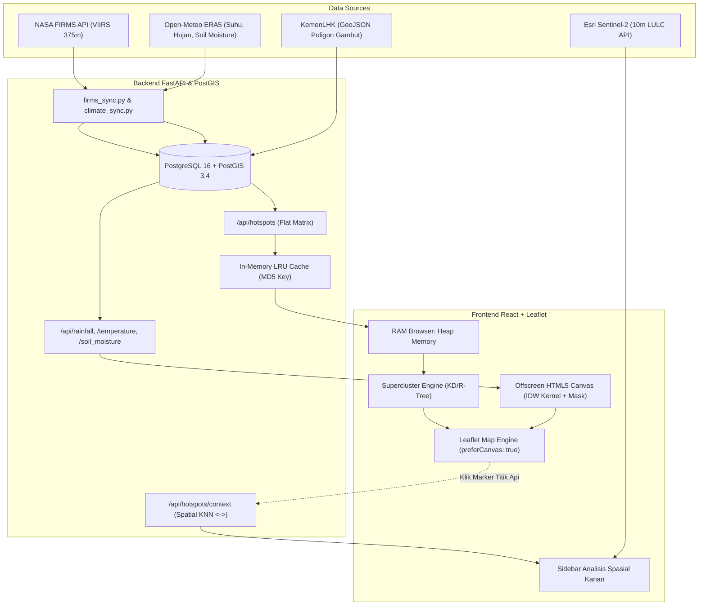

# 🛰️ PANDUAN LENGKAP PRESENTASI ARSITEKTUR & KODINGAN WEBGIS PRIMS KARHUTLA

Dokumen ini disusun sebagai panduan komprehensif untuk menjelaskan alur kerja, konsep geospasial, dan implementasi kode mulai dari Backend (FastAPI + PostGIS) sampai Frontend (React + Leaflet + Canvas + Supercluster).

---

## 📑 DAFTAR ISI
1. [Arsitektur Sistem & Alur Data (Big Picture)](#1-arsitektur-sistem--alur-data-big-picture)
2. [Modul 1: Hotspot (Titik Api) - Dari Flat Matrix ke Supercluster](#2-modul-1-hotspot-titik-api---dari-flat-matrix-ke-supercluster)
3. [Modul 2: Climate (Iklim) - Dari Grid ke HTML5 Canvas Masking](#3-modul-2-climate-iklim---dari-grid-ke-html5-canvas-masking)
4. [Konsep Spasial Kunci: Canvas vs Supercluster vs Spatial KNN](#4-konsep-spasial-kunci-canvas-vs-supercluster-vs-spatial-knn)
5. [Modul 3: Peatland (Gambut) & Land Cover (Tutupan Lahan)](#5-modul-3-peatland-gambut--land-cover-tutupan-lahan)
6. [Daftar Tautan Kode Kunci (Code Reference)](#6-daftar-tautan-kode-kunci-code-reference)
7. [Cheat Sheet Jawaban Pertanyaan Penguji / Dosen](#7-cheat-sheet-jawaban-pertanyaan-penguji--dosen)

---

## 1. Arsitektur Sistem & Alur Data (Big Picture)



---

## 2. Modul 1: Hotspot (Titik Api) - Dari Flat Matrix ke Supercluster

### A. Di Backend: Optimasi Flat Array Matrix
- **File**: [`backend/app/features/hotspot/service.py`](file:///home/allrole/Documents/Mata%20Kuliah/spasial/backend/app/features/hotspot/service.py#L204-L225)
- **Konsep**: Mengirim 50.000 titik api dalam format objek JSON biasa `{lat: -1.2, lng: 114.5, ...}` akan membebani memori dan jaringan hingga 20+ MB. Backend mengubahnya menjadi array 2 dimensi (Flat Matrix) yang memangkas ukuran hingga **75%**.

```python
# backend/app/features/hotspot/service.py (Baris 204-215)
data_matrix: List[List[Any]] = [
    [
        float(row.latitude),       # Index 0: Lat
        float(row.longitude),      # Index 1: Lng
        float(row.brightness),     # Index 2: Suhu kecerahan (Kelvin)
        float(row.frp),            # Index 3: Fire Radiative Power (MW)
        str(row.confidence),       # Index 4: Tingkat keyakinan (h/n/l)
        str(row.acq_date),         # Index 5: Tanggal (YYYY-MM-DD)
        str(row.acq_time)          # Index 6: Jam UTC satelit (HHMM)
    ]
    for row in rows
]
```

### B. In-Memory Cache dengan MD5 Key
- **File**: [`backend/app/features/hotspot/service.py`](file:///home/allrole/Documents/Mata%20Kuliah/spasial/backend/app/features/hotspot/service.py#L37-L41)
- **Konsep**: Parameter filter diurutkan alfabetis (`sort_keys=True`) lalu di-hash menggunakan MD5 menjadi string unik 32 karakter. Jika filter yang sama diminta lagi, data langsung diambil dari RAM dalam **1 ms** tanpa query ulang database.

```python
# backend/app/features/hotspot/service.py (Baris 37-40)
def _make_cache_key(prefix: str, params: dict) -> str:
    serialized = json.dumps(params, sort_keys=True, default=str)
    return f"{prefix}_{hashlib.md5(serialized.encode()).hexdigest()}"
```

### C. Di Frontend: Loading ke Memori RAM Browser & Supercluster
- **File**: [`frontend/src/modules/hotspot/components/HotspotLayer.tsx`](file:///home/allrole/Documents/Mata%20Kuliah/spasial/frontend/src/modules/hotspot/components/HotspotLayer.tsx#L67-L138)
- **Konsep**: Data matriks diubah ke array GeoJSON Feature lalu diumpankan ke pustaka **Supercluster** yang membangun struktur data pohon spasial (**R-Tree / KD-Tree**) di memori RAM browser laptop pengguna.

```tsx
// frontend/src/modules/hotspot/components/HotspotLayer.tsx (Baris 67-104)
function parseFlatMatrixToGeoJson(rows: HotspotMatrixRow[]) {
  return rows.map((row, i) => ({
    type: 'Feature',
    geometry: { type: 'Point', coordinates: [row[1], row[0]] },
    properties: { id: i, lat: row[0], lng: row[1], brightness: row[2], frp: row[3], rawRow: row }
  }));
}

// Inisialisasi Supercluster (Baris 355-385)
const superclusterIndex = useMemo(() => {
  const index = new Supercluster({ radius: 40, maxZoom: 13, minPoints: 2 });
  const points = parseFlatMatrixToGeoJson(activeHotspots);
  index.load(points); // Disimpan dalam struktur pohon R-Tree di RAM Browser
  return index;
}, [activeHotspots]);
```

### D. Rendering Leaflet (Kluster vs Titik Api Tunggal)
- **File**: [`frontend/src/modules/hotspot/components/HotspotLayer.tsx`](file:///home/allrole/Documents/Mata%20Kuliah/spasial/frontend/src/modules/hotspot/components/HotspotLayer.tsx#L142-L347)
- Jika **Zoom Out (Kluster)**: Dipanggil `createClusterMarker()`, membuat lingkaran oranye berisi angka (misal: 444, 255) dengan `L.marker([lat, lng], { icon })`.
- Jika **Zoom In (Titik Tunggal)**: Dipanggil `createSingleFireMarker()`, membuat ikon api membara.

---

## 3. Modul 2: Climate (Iklim) - Dari Grid ke HTML5 Canvas Masking

Data cuaca (Suhu ERA5, Curah Hujan, Kelembaban Tanah) adalah data spasial kontinu (hamparan luasan).

### A. Di Backend: Pemotongan Daratan Indonesia (Database Level)
- Query hanya mengambil titik koordinat darat kepulauan Indonesia:
```sql
SELECT latitude, longitude, suhu_celsius 
FROM temperature 
WHERE is_indonesia = TRUE;
```

### B. Di Frontend: Interpolasi Kernel di Offscreen Canvas
- **File**: [`frontend/src/modules/climate/components/ClimateLayer.tsx`](file:///home/allrole/Documents/Mata%20Kuliah/spasial/frontend/src/modules/climate/components/ClimateLayer.tsx#L108-L209)
- **Konsep**: Titik grid renggang (~30 km) disambungkan menggunakan **Spatial Kernel Interpolation (Cosine/IDW)** pada elemen HTML5 Canvas tak terlihat:

```tsx
// frontend/src/modules/climate/components/ClimateLayer.tsx (Baris 140-165)
const interpRadius = 10; // Radius interpolasi 10 piksel (~1 derajat)
for (let i = 0; i < data.length; i++) {
  const [lat, lng, val] = data[i];
  const x = Math.round((lng - MIN_LON) / GRID_STEP);
  const y = Math.round((MAX_LAT - lat) / GRID_STEP);
  // Sebar bobot nilai ke piksel sekitarnya
  for (const { dx, dy, w } of kernelOffsets) {
    valSum[ny * cols + nx] += val * w;
    weightSum[ny * cols + nx] += w;
  }
}
```

### C. Boundary Masking (Cetakan Garis Pantai Indonesia)
- **File**: [`frontend/src/modules/climate/components/ClimateLayer.tsx`](file:///home/allrole/Documents/Mata%20Kuliah/spasial/frontend/src/modules/climate/components/ClimateLayer.tsx#L183-L206)
- **Konsep**: Warna kanvas yang meluber ke laut lepas dipotong transparan menggunakan teknik grafis `destination-in` dan poligon resmi 34 provinsi:

```tsx
// Potong hanya area daratan kepulauan Indonesia
sCtx.globalCompositeOperation = 'destination-in';
sCtx.drawImage(maskCanvas, 0, 0);

// Export jadi gambar PNG transparan
return canvas.toDataURL('image/png');
```

### D. Georeferencing Leaflet ImageOverlay
- Gambar PNG ditempelkan ke peta dengan mengunci 4 sudut koordinat bumi:
```tsx
const imageBounds = L.latLngBounds([MIN_LAT, MIN_LON], [MAX_LAT, MAX_LON]);
const overlay = L.imageOverlay(dataUrl, imageBounds, { pane: 'climatePane' });
overlay.addTo(map);
```

---

## 4. Konsep Spasial Kunci: Canvas vs Supercluster vs Spatial KNN

| Fitur | Tempat Berjalan | Teknologi | Fungsi Utama |
| :--- | :--- | :--- | :--- |
| **Canvas Raster** | Frontend (Browser) | HTML5 Canvas + `destination-in` | **Menggambar visual warna warni cuaca** (hujan/suhu/kelembaban) di seluruh Indonesia tanpa bocor ke laut. |
| **Supercluster** | Frontend (Browser) | RAM JavaScript + R-Tree | **Mengelompokkan ribuan titik api** menjadi gelembung angka saat peta di-zoom out agar browser tidak *lag*. |
| **Spatial KNN (`<->`)** | Backend (PostGIS Database) | PostGIS R-Tree Index Operator `<->` | **Mencari nilai cuaca terdekat** saat satu titik api diklik user untuk dianalisis di Sidebar Kanan. |

### Query PostGIS Spatial KNN saat Titik Api Diklik:
- **File**: [`backend/app/features/hotspot/queries.py`](file:///home/allrole/Documents/Mata%20Kuliah/spasial/backend/app/features/hotspot/queries.py#L25-L48)
```sql
-- Mencari suhu terdekat dengan koordinat titik api
SELECT suhu_celsius 
FROM temperature, target_time 
WHERE suhu_celsius IS NOT NULL AND waktu = target_time.temp_time
ORDER BY geom <-> ST_SetSRID(ST_MakePoint(:lng, :lat), 4326) 
LIMIT 1;

-- Cek apakah titik api berada di dalam poligon lahan gambut
SELECT EXISTS(
    SELECT 1 FROM peatlands 
    WHERE ST_Intersects(geom, ST_SetSRID(ST_MakePoint(:lng, :lat), 4326))
) as is_peatland;
```

---

## 5. Modul 3: Peatland (Gambut) & Land Cover (Tutupan Lahan)

### A. Peatland Layer
- **Backend** ([`peatland/router.py`](file:///home/allrole/Documents/Mata%20Kuliah/spasial/backend/app/features/peatland/router.py)): Mengembalikan GeoJSON batas Kesatuan Hidrologis Gambut (KHG) Indonesia dari Kementerian LHK.
- **Frontend** ([`spatial.utils.ts`](file:///home/allrole/Documents/Mata%20Kuliah/spasial/frontend/src/shared/utils/spatial.utils.ts)): Menerapkan algoritma **Ray-Casting** berkecepatan tinggi dengan *Bounding Box Pre-indexing* untuk mengecek Point-in-Polygon di sisi klien.

### B. Land Cover Layer (Sentinel-2 10m LULC)
- Saat titik api diklik, frontend menembak REST API resmi Esri ArcGIS ImageServer:
```text
https://ic.imagery1.arcgis.com/arcgis/rest/services/Sentinel2_10m_LandCover/ImageServer/identify?geometry={x:lng,y:lat}&f=json
```
- Menghasilkan kelas tutupan lahan: *Water, Trees, Flooded Vegetation, Crops, Built Area, Bare Ground, Rangeland*.

---

## 6. Daftar Tautan Kode Kunci (Code Reference)

| Bagian Logika | File Sumber | Baris Kunci |
| :--- | :--- | :--- |
| **Flat Matrix Generator** | [hotspot/service.py](file:///home/allrole/Documents/Mata%20Kuliah/spasial/backend/app/features/hotspot/service.py) | L204 – L225 |
| **MD5 Cache Generator** | [hotspot/service.py](file:///home/allrole/Documents/Mata%20Kuliah/spasial/backend/app/features/hotspot/service.py) | L37 – L41 |
| **Dinamis Filter Tanggal** | [hotspot/service.py](file:///home/allrole/Documents/Mata%20Kuliah/spasial/backend/app/features/hotspot/service.py) | L43 – L72 |
| **PostGIS KNN Query** | [hotspot/queries.py](file:///home/allrole/Documents/Mata%20Kuliah/spasial/backend/app/features/hotspot/queries.py) | L25 – L61 |
| **Supercluster Setup** | [HotspotLayer.tsx](file:///home/allrole/Documents/Mata%20Kuliah/spasial/frontend/src/modules/hotspot/components/HotspotLayer.tsx) | L355 – L385 |
| **Kluster & Fire Marker** | [HotspotLayer.tsx](file:///home/allrole/Documents/Mata%20Kuliah/spasial/frontend/src/modules/hotspot/components/HotspotLayer.tsx) | L142 – L347 |
| **Canvas Masking Iklim** | [ClimateLayer.tsx](file:///home/allrole/Documents/Mata%20Kuliah/spasial/frontend/src/modules/climate/components/ClimateLayer.tsx) | L108 – L209 |
| **Georeferenced Overlay** | [ClimateLayer.tsx](file:///home/allrole/Documents/Mata%20Kuliah/spasial/frontend/src/modules/climate/components/ClimateLayer.tsx) | L260 – L275 |
| **Tipologi Karhutla** | [hotspotNarrative.utils.ts](file:///home/allrole/Documents/Mata%20Kuliah/spasial/frontend/src/modules/hotspot/utils/hotspotNarrative.utils.ts) | L73 – L120 |

---

## 7. Cheat Sheet Jawaban Pertanyaan Penguji / Dosen

#### Q1: "Kenapa format data titik api pakai Flat Matrix, bukan GeoJSON dari backend?"
> *"Jika mengirim puluhan ribu titik api dalam format GeoJSON standar, setiap titik membawa nama key yang berulang (`latitude`, `longitude`, `brightness`), ukuran file bisa tembus 20 MB dan membuat browser hang.*  
> *Dengan Flat Matrix array 2D `[[lat, lng, val, ...], ...]`, ukuran payload terpangkas hingga 75% (~4 MB). Data baru dipetakan ke GeoJSON di memori RAM browser klien sebelum masuk ke Supercluster."*

#### Q2: "Bagaimana cara sistem tahu titik api berada di lahan gambut?"
> *"Di backend, kami menggunakan fungsi PostGIS `ST_Intersects(geom, ST_SetSRID(ST_MakePoint(lng, lat), 4326))` terhadap tabel poligon kubah gambut KLHK.*  
> *Di frontend untuk respon instan tanpa request jaringan, kami mengimplementasikan algoritma **Ray-Casting** yang dioptimasi dengan Bounding Box pre-filter."*

#### Q3: "Bagaimana titik api bisa tahu suhu dan curah hujan jika koordinat stasiun cuaca berbeda?"
> *"Kami menggunakan **PostGIS Spatial KNN (K-Nearest Neighbors)** dengan operator `<->` berbasis indeks R-Tree GIST. Operator ini mencari titik pengukuran cuaca terdekat dari koordinat kebakaran secara instan dalam waktu kurang dari 1 milidetik tanpa perlu menghitung jarak ke seluruh baris tabel database."*

#### Q4: "Bagaimana layer raster iklim tidak tumpah ke laut atau negara tetangga?"
> *"Ada 2 lapis penyaringan:*  
> *1. Di database: `WHERE is_indonesia = TRUE` membuang titik laut saat query.*  
> *2. Di frontend: Kami menggunakan teknik grafis **HTML5 Canvas `destination-in` Masking** yang memotong piksel raster menggunakan batas resmi poligon 34 provinsi Indonesia, sehingga warna cuaca terpotong rapi mengikuti kontur kepulauan."*

#### Q5: "Apa bedanya Kebakaran Gambut Smoldering vs Api Permukaan?"
> *"Jika titik api berada di dalam Kesatuan Hidrologis Gambut (KHG) dan kelembaban tanah kritis ($< 0.25\text{ m}^3/\text{m}^3$), sistem mengklasifikasikannya sebagai **Smoldering Peat Fire** (api membara lambat di bawah permukaan tanah tanpa kobaran terbuka, menghasilkan emisi asap pekat PM2.5 & CO).*  
> *Sebaliknya di tanah mineral atau gambut basah, api berada di permukaan (*Surface Fire*) membakar semak dan kanopi."*
