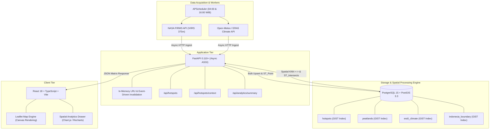

# Product Requirements Document (PRD)

## Sistem WebGIS Pemantauan Titik Api (NASA FIRMS) & Analisis Spasial Ekosistem Gambut Indonesia

---

### 1. Executive Summary

- **Problem Statement**:
  Peneliti kebencanaan dan akademisi geospasial menghadapi fragmentasi data yang parah antara deteksi anomali termal satelit (NASA FIRMS) dengan parameter biofisik lingkungan (kubah gambut, tutupan lahan Sentinel-2, dan iklim mikro ERA5), sehingga verifikasi penyebab kebakaran hutan dan lahan (karhutla) serta analisis kerentanan ekosistem gambut membutuhkan waktu berjam-jam secara manual melalui software GIS desktop.
- **Proposed Solution**:
  Sebuah platform WebGIS analitik terintegrasi berbasis PostGIS dan FastAPI yang mengotomatisasi pengunduhan data titik api secara near-real-time (NRT), melakukan spatial join sub-milidetik dengan batas kubah gambut dan interpolasi cuaca, serta menyediakan model inferensi spasial kuantitatif (Multi-Criteria Evaluation & Forensik Pemicu Ulah Manusia vs Alami).
- **Success Criteria**:
  1. **Latency Response Query Spasial**: P95 query titik api agregat dan environmental context (point spatial join) selesai dalam kurun waktu **< 200 ms** untuk volume dataset > 2.000.000 record historis.
  2. **Automated Pipeline Reliability**: Eksekusi sinkronisasi data satelit NASA FIRMS dan iklim dinamis berjalan otomatis 2x sehari (pukul 04:00 & 16:00 WIB) dengan tingkat keberhasilan (uptime job) **>= 99.5%**.
  3. **Visual Rendering Throughput**: Frontend Leaflet mampu merender hingga **>= 20.000 titik hotspot aktif** secara simultan menggunakan Canvas Vector Renderer dengan frame rate minimum **>= 45 FPS** saat panning/zooming.
  4. **Data Accuracy & Precision**: Eliminasi 100% false-positive hotspot di luar teritori darat Indonesia melalui automated PostGIS boundary clipping poligon 34 Provinsi.

---

### 2. User Experience & Functionality

#### User Personas
- **Primary Persona**: **Peneliti & Akademisi Geospasial / Sains Lingkungan (Spatial Disaster Researcher)**
  - *Karakteristik*: Membutuhkan akses cepat ke korelasi titik api dengan parameter biofisik (suhu, defisit hujan, kelembaban tanah, tutupan lahan), menguji hipotesis penyebab kebakaran (slash-and-burn vs cuaca ekstrem), serta mengunduh/menganalisis pola spasio-temporal karhutla tanpa instalasi software GIS yang berat.
- **Secondary Persona**: **Analis Data Kebencanaan & Pengambil Kebijakan Wilayah (Disaster Risk Analyst)**
  - *Karakteristik*: Memerlukan dashboard visual interaktif level provinsi/pulau untuk memantau hotspot di kubah gambut berstatus kritis dan mengevaluasi tren 5 hari terakhir untuk alokasi prioritas mitigasi.

#### User Stories & Acceptance Criteria

- **Story 1 (Visualisasi Spasial Multilapis & Pemfilteran Wilayah)**:
  - *Story*: Sebagai Peneliti Geospasial, saya ingin memfilter titik api berdasarkan tanggal, sensor (VIIRS S-NPP / NOAA-20), tingkat kepercayaan, serta batas administratif provinsi/pulau sehingga saya dapat mengisolasi area kajian spesifik secara instan.
  - *Acceptance Criteria*:
    - UI menyediakan dropdown navbar: Layer (Hotspot, Gambut, Tutupan Lahan, Suhu, Hujan, Soil Moisture), Wilayah (Pulau & 34 Provinsi), Kalender tanggal, dan Basemap Switcher (Esri World Imagery vs Carto Positron).
    - Memilih provinsi secara otomatis memicu animasi zoom (`flyToBounds`) ke ekstensi poligon batas provinsi terkait.
    - Toggle visualisasi mendukung pergantian instan antara representasi *Marker Canvas* individual dan *Heatmap Layer* termal.
    - Representasi visual titik api, klaster, dan widget analitik menggunakan standar 3 range suhu kecerahan (gradien api tanpa warna hijau): *Ekstrem* ($\ge 350\text{ K} / \ge 77^\circ\text{C}$ - Merah), *Tinggi* ($335 - 349\text{ K} / 62 - 76^\circ\text{C}$ - Oranye), dan *Sedang* ($< 335\text{ K} / < 62^\circ\text{C}$ - Amber).
    - Semua titik api di luar batas resmi NKRI atau di perairan laut terpotong (*clipped*) secara otomatis.

- **Story 2 (Inspeksi Kontekstual Titik Api, Tipologi Kebakaran & Rekomendasi Aksi)**:
  - *Story*: Sebagai Akademisi & Praktisi Lingkungan, saya ingin mengeklik titik api mana saja di peta untuk melihat profil biofisik lokal, tipologi kebakaran (gambut vs permukaan vs kanopi), pola spasial pembukaan lahan, serta rekomendasi aksi mitigasi taktis lapangan.
  - *Acceptance Criteria*:
    - Klik pada marker hotspot membuka drawer *Sidebar Analisis Spasial* di sisi kanan tanpa modal pop-up yang menutupi kanvas peta.
    - Menghitung 3 pilar inferensi spasial berbasis parameter lingkungan riil:
      1. **Tipologi Kebakaran & Potensi Asap Gambut**: Mendeteksi kebakaran bawah tanah (*smoldering peat fire*), kebakaran permukaan (*surface fire*), atau kebakaran kanopi (*forest fire*).
      2. **Pola Spasial & Indikasi Aktivitas Lahan**: Mengidentifikasi indikasi pembukaan lahan terencana (*land clearing* massal), perambahan hutan aktif, atau titik api tunggal terisolasi.
      3. **Rekomendasi Aksi Mitigasi Lapangan**: Penentuan skala prioritas (Prioritas 1: *Water Bombing* helikopter & pembasahan gambut, Prioritas 2: Pemadaman taktis satgas darat & parit sekat bakar, Prioritas 3: Patroli rutin).
    - Mengembalikan jarak euklidian ke titik api terdekat (*Nearest Neighbor Distance*) dan jumlah hotspot tetangga dalam radius 15 km (`ST_Expand` 0.15°).
    - Menampilkan data cuaca ERA5 terdekat: Suhu 2m (°C), Curah Hujan (mm), dan Kelembaban Tanah ($m^3/m^3$) via operator PostGIS KNN (`<->`).

- **Story 3 (Multi-Criteria Evaluation Skor Risiko Karhutla)**:
  - *Story*: Sebagai Analis Risiko, saya ingin melihat indeks skor keparahan titik api berskala 0–100 poin berbasis karakteristik gambut dan defisit air agar tim mitigasi dapat memprioritaskan area yang berpotensi menimbulkan kabut asap pekat.
  - *Acceptance Criteria*:
    - Mengomputasi formula pembobotan MCE:
      $$\text{Skor Risiko} = S_{\text{Gambut}} (35\%) + S_{\text{Kekeringan}} (25\%) + S_{\text{Defisit Hujan}} (20\%) + S_{\text{FRP}} (20\%)$$
    - Titik api diklasifikasikan ke dalam 4 kuadran: *Sangat Kritis / Ekstrem* ($\ge 75$), *Tinggi* ($50 - 74$), *Sedang* ($30 - 49$), dan *Rendah / Waspada* ($< 30$) dengan kode warna visual standar gradien api (merah pekat, oranye, kuning amber, kuning emas - tanpa warna hijau).
    - Sidebar merender progress bar terperinci per sub-kriteria skor.

- **Story 4 (Dashboard Ringkasan Eksekutif & Tren Hotspot)**:
  - *Story*: Sebagai Pengambil Kebijakan, saya ingin melihat metrik agregasi harian nasional (total hotspot, persentase di kubah gambut, rata-rata FRP, dan 5 provinsi terparah) agar dapat membuat laporan situasi berkala.
  - *Acceptance Criteria*:
    - Endpoint `/api/analytics/summary` menyajikan kartu ringkasan KPI nasional untuk tanggal aktif.
    - Menampilkan tabel / leaderboard 5 Provinsi dengan hotspot tertinggi lengkap dengan rasio gambut dan confidence tinggi.
    - Grafik tren historis 5 hari terakhir (*time-series bar/line chart*).

#### Non-Goals
1. **Bukan Sistem Pemadam / Dispatcher Armada**: Tidak menyediakan modul pelacakan GPS armada pemadam kebakaran Manggala Agni secara real-time.
2. **Bukan Pengganti Analisis Citra Satelit Resolusi Super-Tinggi**: Tidak melakukan segmentasi poligon luka bakar (*burned area scar*) resolusi sub-meter (PlanetScope/WorldView).
3. **Bukan Platform Transaksional / Crowdsourcing**: Tidak menyediakan formulir pengaduan masyarakat umum secara crowdsourced berbasis input mobile native.
4. **Bukan Model Prediksi Cuaca Mandiri**: Menggunakan reanalisis ECMWF ERA5 & Open-Meteo, tidak menjalankan model Numerical Weather Prediction (NWP) skala WRF di server lokal.

---

### 3. AI & Spatial Inference System Requirements

Meskipun sistem berfokus pada analisis geospasial berbasis aturan dan komputasi spasial deterministik (Spatial Expert System / Heuristic Spatial Inference), sistem mengintegrasikan model evaluasi parameter multi-kriteria:

#### Model & Inference Requirements
- **Forensic Causation Rule-Engine**:
  - *Baseline Prior*: $85\%$ probabilitas faktor antropogenik (berdasarkan literatur karhutla tropis Indonesia).
  - *LULC Sensitivity*: Modifikasi $+8\%$ pada lahan semak belukar / agroforestri terfragmentasi; penyesuaian pada tutupan hutan primer.
  - *Clustering Weight*: Modifikasi $+5\%$ bila $\ge 10$ titik api berada dalam radius 15 km (indikasi *slash-and-burn* serentak korporasi/kelompok), atau $-15\%$ jika titik api terisolasi (*outlier* lokal).
  - *Thermal Sensitivity*: Modifikasi $-10\%$ faktor manusia jika suhu udara permukaan $> 34^\circ\text{C}$ dan kelembaban tanah $< 0.15\text{ m}^3/\text{m}^3$.

#### Tool & External Data API Requirements
- **NASA FIRMS API**: Endpoint VNP14IMGTDL / VIIRS S-NPP Near-Real-Time (resolusi 375m) dengan parameter MAP_KEY resmi.
- **Open-Meteo Historical & Climate Forecast API**: Ekstraksi variabel `temperature_2m`, `precipitation`, dan `soil_moisture_0_to_7cm` berbasis grid koordinat dinamis.
- **Sentinel-2 10m Land Use Land Cover (LULC)**: Klasifikasi tutupan lahan 9 kelas (Esri/Impact Observatory).
- **KemenLHK Peta Fungsi Ekosistem Gambut**: Klasifikasi kubah gambut fungsi lindung dan fungsi budidaya.

#### Evaluation & Validation Strategy
- **Ground Truth Validation**: Membandingkan hasil klasifikasi MCE dan pemicu api dengan data kejadian lapangan Sipongi+ KemenLHK pada 100 sampel titik api representatif di Riau, Kalimantan Tengah, dan Sumatera Selatan.
- **Threshold Kalibrasi**: Uji sensitivitas radius kluster spasial (10 km vs 15 km vs 20 km) untuk meminimalkan *noise clustering* terhadap dispersi sensor satelit.
- **Execution Performance Benchmark**: Uji benchmark PostGIS terhadap 500 query concurrent spasial untuk memastikan fungsi inferensi selesai dalam **< 50 ms per kalkulasi titik**.

---

### 4. Technical Specifications

#### Architecture Overview
Arsitektur sistem menggunakan pola modern **Decoupled Geospatial Service**:



#### Database Schema & Spatial Optimization
1. **Spatial Indexes**: Kolom `geom` (proyeksi `EPSG:4326` WGS84) diindeks menggunakan **GIST** (*Generalized Search Tree*) di setiap tabel geospasial.
2. **K-Nearest Neighbors (KNN Spasial)**:
   Menggunakan operator native `<->` pada pencarian data iklim terdekat untuk memangkas *table scan* linier menjadi penelusuran *R-Tree Index* berskala mikrodetik:
   ```sql
   SELECT suhu_celsius, curah_hujan_mm, soil_moisture
   FROM climate_daily
   ORDER BY geom <-> ST_SetSRID(ST_MakePoint(:lng, :lat), 4326)
   LIMIT 1;
   ```
3. **Boundary Clipping Pre-Filtering**:
   Field `is_indonesia BOOLEAN` telah terindeks dan diperbarui via `ST_Intersects` dengan poligon batas negara darat sehingga backend mengecualikan titik laut dan negara tetangga langsung pada query level `WHERE is_indonesia = TRUE`.
4. **Trigger Database Pre-Enrichment**:
   Setiap baris hotspot yang disisipkan otomatis diperkaya (*pre-enriched*) atribut `province` dan `is_peatland` saat *insert*, menghilangkan beban overhead komputasi *polygon intersection* saat dashboard diakses.

#### Integration Points & APIs
- `GET /api/hotspots`: Mengembalikan matriks data titik api ringan (Flat Array Matrix) untuk mereduksi beban serialisasi JSON hingga 70% dibanding GeoJSON standar.
- `GET /api/hotspots/context?lat={lat}&lng={lng}&date={date}`: Menghasilkan rincian spasial titik: status gambut, 3 parameter cuaca terdekat, skor MCE, dan kluster tetangga.
- `GET /api/analytics/summary?date={date}`: Metrik agregasi KPI nasional, peringkat top 5 provinsi, dan sebaran kelas risiko.
- `POST /api/hotspots/sync-now`: Manual on-demand sync trigger dengan proteksi konkurensi.

#### Security & Operational Integrity
- **CORS Restricted Origin**: Akses API dibatasi ke origin terdaftar (domain aplikasi WebGIS).
- **Environment Isolation**: Kredensial sensitif (`FIRMS_MAP_KEY`, `POSTGRES_PASSWORD`) dikelola via environment variable Docker (.env).
- **Read-Heavy Caching**: Implementasi LRU Caching dengan *event-driven invalidation* yang hanya me-reset memori setelah batch write dari modul sinkronisasi selesai, mencegah kondisi *cache stampede*.

---

### 5. Risks & Roadmap

#### Phased Rollout

| Fase | Target Milestone | Ruang Lingkup & Deliverables |
| :--- | :--- | :--- |
| **Fase 1: MVP (Current State)** | *Current Baseline (Tercapai)* | - Integrasi NASA FIRMS NRT 5-hari & arsip historis.<br>- PostGIS Spatial KNN, GIST Indexing, Boundary Clipping 34 Provinsi.<br>- Model MCE 0-100 poin & Forensik Pemicu Manusia vs Alami.<br>- React Canvas Marker Renderer & Sidebar Drawer Analisis. |
| **Fase 2: v1.1 (Enhancement & Export)** | *Q1 Target* | - Fitur Ekspor Data Spasial multi-format (GeoJSON, ESRI Shapefile .shp, CSV).<br>- Dynamic Buffer Ring visualizer (radius 5 km & 15 km) langsung pada kanvas Leaflet.<br>- Peringatan anomali titik api harian otomatis via Webhook Telegram/Email. |
| **Fase 3: v2.0 (Predictive AI & Spatio-Temporal Modeling)** | *Q2 Target* | - Pelatihan model Machine Learning (Random Forest / XGBoost) untuk Fire Susceptibility Index harian berbasis cuaca ramalan.<br>- Analisis Spatio-temporal Hotspot Hotspot Trajectory (estimasi arah rambatan api berdasarkan kecepatan angin ERA5).<br>- Integrasi layer citra satelit Sentinel-2 True Color (B4-B3-B2) dan SWIR (B12-B8-B4) on-the-fly via WMS/WMTS. |

#### Technical Risks & Mitigations

| Risiko Teknis | Dampak | Probabilitas | Strategi Mitigasi |
| :--- | :--- | :---: | :--- |
| **Rate Limit / Kegagalan NASA FIRMS API** | Sinkronisasi titik api terbaru tertunda. | Sedang | Mekanisme *exponential backoff retry* pada APScheduler dan *fallback* ke data cache siklus sebelumnya tanpa menghentikan aplikasi. |
| **Degradasi Memory Heap Browser pada >50k Points** | UI Leaflet mengalami stuttering saat zoom. | Sedang | Pemanfaatan Leaflet Canvas Vector Tile / Supercluster clustering di level frontend dan limitasi query default 20.000 titik. |
| **Ketidaksesuaian Resolusi Grid Iklim (0.25° vs Titik 375m)** | Ketidakakuratan lokal data hujan di topografi berbukit. | Rendah | Menggunakan interpolasi spasial Inverse Distance Weighting (IDW) atau nearest cell dengan dokumentasi batasan spasial di sidebar. |
| **Beban Query Spasial Paralel Tinggi** | Latensi API backend melonjak di atas target 200ms. | Rendah | *Pre-enrichment* pada tabel hotspot saat ingestion dan *read-through caching* pada endpoint analitik. |
