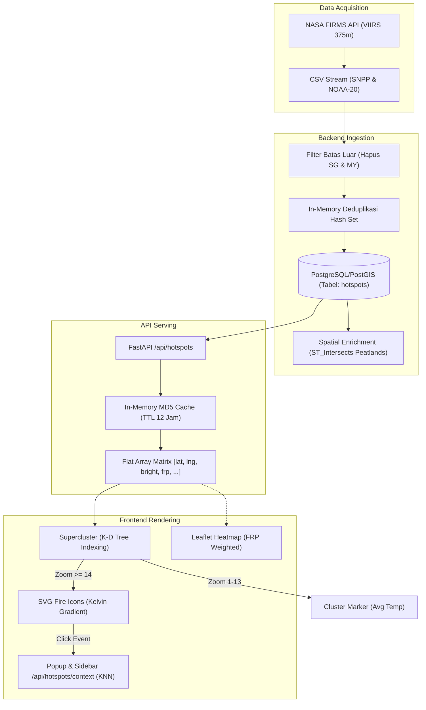

#  Modul Hotspot (Titik Api)

Dokumentasi arsitektur dan alur pemrosesan data titik api (*fire hotspots*) dari satelit hingga divisualisasikan pada peta interaktif WebGIS.

---

## ️ Alur End-to-End Pemrosesan Hotspot



---

## 1. Pengambilan Data Satelit (Data Acquisition)
* **Sensor**: VIIRS (Visible Infrared Imaging Radiometer Suite) pada satelit **S-NPP** dan **NOAA-20** dengan resolusi spasial tinggi **375 meter**.
* **Jalur API**: Mengambil stream CSV dari NASA LANCE / FIRMS:
  ```
  https://firms.modaps.eosdis.nasa.gov/api/area/csv/{MAP_KEY}/{SOURCE}/{BBOX}/{DAY_RANGE}
  ```
* **Bounding Box Indonesia**: `95.0, -11.0, 141.0, 6.0`.
* **Filter Batas Spasial Awal**: Koordinat yang masuk disaring secara matematis untuk membuang titik api di negara tetangga (Semenanjung Malaysia, Sabah, Sarawak, dan Singapura).

---

## 2. Deduplikasi In-Memory & Ingesti PostGIS
* **Deduplikasi 2 Lapis**:
  1. *Database Hash Set*: Mengekstrak `(latitude, longitude, acq_date, acq_time)` yang sudah ada di database untuk rentang tanggal terkait.
  2. *Internal Batch Set*: Memastikan jika satelit NOAA-20 dan S-NPP mendeteksi titik yang sama, tidak terjadi duplikasi insert.
* **Bulk Insert**: Menggunakan PostgreSQL chunk insert (`chunk_size = 1000`) dengan klausa `ON CONFLICT DO NOTHING`.
* **Geometri PostGIS**: Disimpan sebagai tipe geometri `Point` SRID 4326 dengan indeks spasial `GIST(geom)`.

---

## 3. Spatial Enrichment Otomatis
Setelah titik api baru tersimpan:
* **Spatial Join Gambut**:
  ```sql
  UPDATE hotspots h
  SET is_peatland = TRUE
  FROM peatlands p
  WHERE (h.is_peatland IS NULL OR h.is_peatland = FALSE)
    AND h.geom && p.geom AND ST_Intersects(h.geom, p.geom);
  ```
* **Auto Dynamic Climate Sync**: Sistem memicu fetch data iklim harian (Open-Meteo) untuk koordinat hotspot baru tersebut.

---

## 4. Serving API & Optimasi Flat Matrix
* **Endpoint**: `GET /api/hotspots`
* **Optimalisasi Bandwidth (Flat Array Matrix)**: Data tidak dikirimkan dalam format JSON Object berulang (`[{"lat": ...}, ...]`), melainkan matriks 2D:
  ```json
  [
    [-2.341, 104.562, 342.5, 15.2, "nominal", "2026-11-15", "0615"],
    ...
  ]
  ```
  *Menghemat ukuran transfer payload hingga ~70% dan mempercepat waktu parsing browser untuk 20.000+ data.*

---

## 5. Rendering Peta Frontend
Komponen `HotspotLayer.tsx` memproses data matriks menjadi tampilan interaktif:

### A. Pengelompokan Spasial Dinamis (Supercluster)
* Menggunakan algoritma **K-D Tree (Supercluster)** dengan radius 40px dan maxZoom 13.
* **Pada Zoom 1 – 13**: Titik yang berdekatan otomatis melebur menjadi bulatan klaster yang menampilkan:
  - Jumlah titik dalam klaster.
  - Rata-rata suhu kecerahan titik api di klaster tersebut.
* **Pada Zoom $\ge$ 14**: Klaster pecah menjadi ikon api individual (SVG flame marker).

### B. Pewarnaan Suhu Kecerahan (Gradien Api Murni)
Warna titik api dan klaster ditentukan oleh temperatur sensor VIIRS (Bright TI4):
* **$\ge 350\text{ K}$ ($\ge 77^\circ\text{C}$)** :  **Merah Pekat** (`#dc2626`) – Tingkat Ekstrem / Darurat.
* **$335 - 349\text{ K}$ ($62 - 76^\circ\text{C}$)** :  **Oranye** (`#ea580c`) – Tingkat Tinggi.
* **$< 335\text{ K}$ ($< 62^\circ\text{C}$)** :  **Kuning Amber** (`#f59e0b`) – Tingkat Sedang / Waspada.

### C. Mode Heatmap (Alternatif)
Jika user mengaktifkan mode Heatmap, sistem merender kanvas `leaflet.heat` dengan intensitas terbobot berdasarkan **FRP (Fire Radiative Power)** dalam satuan Megawatt (MW).

### D. Interaktivitas Klik (Spatial KNN & Context)
Ketika sebuah titik api diklik:
* Frontend memanggil `GET /api/hotspots/context?lat=...&lng=...&date=...`.
* Backend melakukan **PostGIS KNN Operator (`<->`)** untuk mencari data cuaca (curah hujan, suhu, soil moisture) dan kluster terdekat dalam waktu **< 15 ms**.
* Informasi ditampilkan pada popup dan *Sidebar Analitik Karhutla*.
